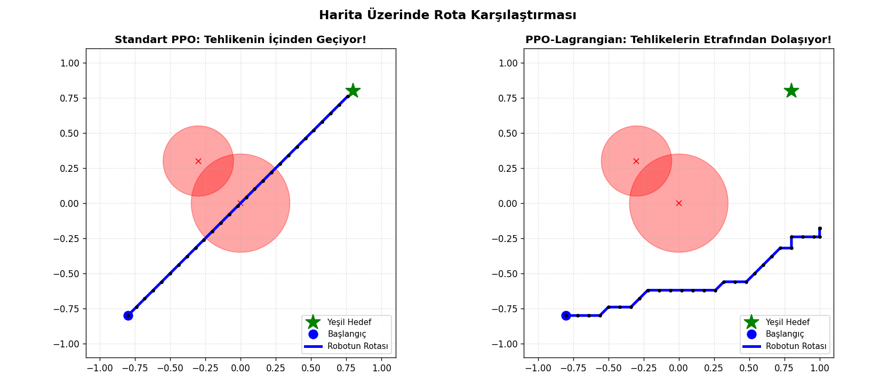

# Safe RL Navigation

**A 2D robot navigation experiment comparing a reward-only Actor–Critic agent with an agent using an adaptive Lagrangian safety penalty.**

Built with Python, NumPy, and PyTorch. The notebook explores how penalizing time spent in hazardous regions changes the route an agent learns, and the tradeoff between hazard avoidance and reaching its goal.

[Explore the notebook](Safe_RL.ipynb) · [View the route comparison](safe_rl_rotalar.png)



> **Reading the figure:** red circles are hazardous regions, the blue point is the start, and the green star is the goal. In this recorded rollout, the reward-only agent crosses a hazard and reaches the goal. The Lagrangian agent avoids the circles but ends short of the goal when its 30-step budget expires.

## What this project demonstrates

- A custom environment with separate task rewards and safety costs.
- Neural policies trained from complete episodes using reward and cost value baselines.
- An adaptive penalty that increases when an episode exceeds the hazard budget.
- Training logs and sampled trajectories that reveal the reward–safety tradeoff.

This is an educational simulation of constrained reinforcement learning. The notebook and plot retain their original Turkish comments and labels.

### A note on the algorithm names

The original notebook and plot use the labels **“Standard PPO”** and **“PPO-Lagrangian.”** The implemented update is an episodic Actor–Critic policy gradient with Monte Carlo returns. It does not implement PPO's old/new policy probability ratio, clipped surrogate objective, or repeated minibatch optimization. Accordingly, this README describes the actual code as **reward-only Actor–Critic** and **Lagrangian Actor–Critic**.

## Environment

`SafeNavEnv` is a small custom Python simulator. It exposes its own `reset()` and `step()` methods; it is not a registered Gymnasium environment.

| Property | Configuration |
| --- | --- |
| Workspace | Square bounded by `[-1, 1]` on both axes |
| Start | `(-0.8, -0.8)` |
| Goal | `(0.8, 0.8)` |
| Hazard 1 | Center `(0.0, 0.0)`, radius `0.35` |
| Hazard 2 | Center `(-0.3, 0.3)`, radius `0.25` |
| Observation | 6 values: position, vector to goal, and distances to both hazard centers |
| Actions | Stay, up, down, left, right, and diagonal up-right |
| Movement | `0.08` per cardinal move; `0.06` on each axis for the diagonal move |
| Task reward | Negative distance to goal, with a `+10` bonus upon reaching it |
| Goal condition | Distance to goal below `0.12` |
| Episode horizon | At most 30 steps |
| Safety cost | `1` if the post-action position is inside either hazard; otherwise `0` |
| Cost budget | 2 hazard-occupancy steps per episode |

**How to interpret cost:** the reported Turkish metric `Kaza Adımı` counts steps spent inside a hazard. Remaining inside a region for several steps adds a cost on each step. Being inside both regions still costs only `1` for that step. It is a simulated occupancy metric, not a count of distinct physical collisions. The code checks the endpoint of a move rather than the full segment between positions.

## Learning method

The policy maps six observations to a categorical distribution over six actions. Two value networks estimate discounted reward returns and discounted cost returns.

| Training setting | Value |
| --- | --- |
| Policy network | `6 → 64 → 64 → 6`, Tanh hidden layers |
| Each value network | `6 → 64 → 64 → 1`, Tanh hidden layers |
| Optimizer | Adam |
| Policy learning rate | `0.001` |
| Reward/cost value learning rate | `0.002` |
| Discount factor | `0.95` |
| Training episodes | 400 per mode, with separate network initialization for each mode |
| Policy/value updates | One update per network after each episode |
| Initial penalty multiplier | `0.0` |
| Multiplier learning rate | `0.05` |
| Console reporting | Every 50 episodes |

The environment resets to the same start on each episode. The two modes initialize separate networks; their random initialization and action samples are not controlled by a fixed seed.

For a step `t`, the baselines produce the advantages

$$
A^r_t = G^r_t - V_r(s_t), \qquad A^c_t = G^c_t - V_c(s_t),
$$

where both `G` values are discounted Monte Carlo returns. The policy minimizes

$$
L_{\pi} = -\sum_t \log\pi_{\theta}(a_t \mid s_t)\left(A^r_t - \lambda A^c_t\right).
$$

The reward-only mode uses just the reward advantage. The Lagrangian mode combines reward and cost advantages, then updates its nonnegative penalty after the episode:

$$
\lambda \leftarrow \max\left(0,\;\lambda + 0.05\left(C_{\mathrm{episode}} - 2\right)\right).
$$

Here `C_episode` is the **undiscounted** sum of occupancy costs. The actor's cost advantage is discounted, while this multiplier update uses the undiscounted episode cost. This is a compact teaching implementation rather than a formally verified constrained optimizer. The budget adjusts a learned penalty; it does not block unsafe actions.

## Recorded results

The notebook contains the following averages for **training episodes 351–400**. These numbers come from its saved console output; they are not a separate evaluation run.

| Metric | Reward-only Actor–Critic | Lagrangian Actor–Critic |
| --- | ---: | ---: |
| Mean episode return | `-19.46` | `-41.54` |
| Mean hazard-occupancy steps | `8.1` | `1.5` |
| Penalty multiplier after episode 400 | `0.00` | `1.20` |

The Lagrangian run records fewer hazard-occupancy steps and a lower task return. The supplied trajectory figure illustrates why both measures matter: avoiding hazards is useful, but a route that fails to reach the goal is not a completed navigation task.

Each plotted trajectory is generated by sampling actions from its trained policy. A different rollout may produce a different path. The plot is not a success-rate benchmark, and the last-50-episode cost average does not establish that every episode respects the budget.

## Run the notebook

### Google Colab

1. Open [Google Colab](https://colab.research.google.com/) and upload `Safe_RL.ipynb`.
2. Run the cells in order. The setup cell installs the packages; the next cell trains both agents.
3. Run the trajectory cell to display the comparison and save `safe_rl_rotalar.png` in the current runtime.
4. Download the generated PNG before closing the runtime if you want to keep the new result.

The networks use CPU tensors. A GPU is not required by this implementation.

### Local Jupyter

Use a Python environment compatible with PyTorch. Install the notebook dependencies and JupyterLab:

```bash
python -m pip install numpy torch matplotlib gymnasium imageio ipython jupyterlab
python -m jupyter lab Safe_RL.ipynb
```

If you have already installed the dependencies, skip the first installation cell. Run the training cell and then the plotting cell. The plotting cell expects `policy_std` and `policy_safe` from the completed training cell.

For a quick run, reduce `total_episodes=400` in both calls at the end of the training cell. This changes the experiment and will not reproduce the recorded results above. Re-running the plotting cell overwrites the local `safe_rl_rotalar.png` with a newly sampled comparison.

Gymnasium is installed by the original setup cell, and ImageIO/IPython are imported, but the current simulator and static trajectory plot do not depend on their APIs. They are retained to match the supplied notebook.

## Repository files

| File | Purpose |
| --- | --- |
| [Safe_RL.ipynb](Safe_RL.ipynb) | Original notebook with environment, networks, training, and saved outputs |
| [safe_rl_rotalar.png](safe_rl_rotalar.png) | Original comparison of sampled agent trajectories |
| [README.md](README.md) | Project overview, method, results, and run instructions |

## Reproducibility and next steps

The saved notebook shows one run without fixed random seeds. It does not include exported model checkpoints, raw metric files, or evaluation across multiple seeds and maps. Its setup cell installs unpinned packages, so future environments can differ from the recorded runtime. The provided code and image are preserved unchanged.

Useful extensions are to:

- Run multiple seeds and report goal-success rate, hazard cost, timeout rate, and path length together.
- Evaluate trained policies separately from training, including deterministic and sampled actions.
- Add seeds, dependency versions, checkpoint saving, and structured metric exports.
- Test unseen hazard arrangements and tune the horizon and cost budget.
- Implement the complete clipped PPO objective if comparing against PPO or PPO-Lagrangian.

## Background reading

- Schulman et al. (2017), [Proximal Policy Optimization Algorithms](https://arxiv.org/abs/1707.06347) — background for the PPO naming distinction.
- Stooke, Achiam, and Abbeel (2020), [Responsive Safety in Reinforcement Learning by PID Lagrangian Methods](https://arxiv.org/abs/2007.03964) — background on adaptive Lagrange multipliers; this notebook implements a simple multiplier update, not their PID method.

---

**Author:** [Ercan Sevdi](https://github.com/ercansevdi)

